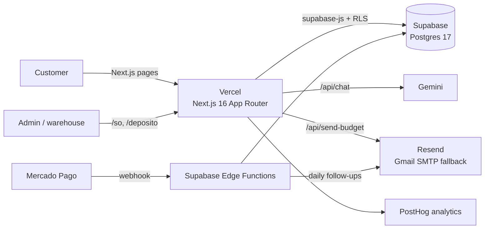

# On The Rocks OS

**Public website + internal sales system for a mobile cocktail bar business in Tandil, Argentina.**
In production at **[ontherockstandil.com.ar](https://ontherockstandil.com.ar)** since 2026, used every day by the business owner and by real customers.

> This repository is a **case study**. The application code lives in a private repository because it contains customer data, business pricing and operational scripts. Happy to walk through the code in an interview.

---

## The problem

The business ran on WhatsApp and spreadsheets. Quotes were calculated by hand, follow-ups depended on memory, and there was no way to know which events were won, lost, or why. The goal was a single system covering the full sales cycle, built and operated by one developer.

## What it does

**For customers (public site)**
- Landing pages per event type (weddings, corporate, birthdays, courses).
- Quote request **without creating an account**, with a tracking code to check its status later.
- Branded online budget (`/p/[code]`), protected by an email gate, with one-tap reply.
- Online **deposit payment with Mercado Pago** (checkout + webhook), behind a switch until the business enables it.
- AI assistant scoped to the business (see below).
- Optional customer account with email/password and TOTP two-factor authentication.

**For the business (admin system, `/so`)**
- Internal quote builder with **cost and margin** per budget.
- Kanban sales pipeline with status, loss reason and contact history.
- Daily "follow up today" list, plus **automatic follow-up emails** sent by a scheduled Edge Function.
- KPI dashboard: conversion, funnel, margin and loss reasons per event type.
- Editable price list with price history and validity dates; supplier prices imported from their PDF price list.
- Budgets exported as PDF, email and WhatsApp message.
- Course enrollment with a personal payment link per student, referral codes, and Instagram metrics sync.
- **Inventory app** for the warehouse role (bottles tracked by fill level, utensils and glassware with photos), designed mobile-first for use on a phone.

## Architecture

- **Business logic lives in `src/lib/` with no UI code**, so the same pricing functions run in the web app, the PDF generator and the tests.
- **Row Level Security on every table.** The browser only uses the public key; access is decided in Postgres by role (`admin`, `deposito`, customer). Admin access requires a second factor when one is enrolled (`aal2`).
- **36 SQL migrations** and a reproducible schema dump, tested against an empty database.
- **5 Edge Functions**: payment webhook, deposit and course checkouts, daily follow-up emails, Instagram sync.

## AI assistant

Three layers, in order:

1. **Deterministic first.** Intent detection, a quoting tool and an FAQ answer locally. "Premium bar for 120 guests" returns a real price even with no API key.
2. **LLM second.** Gemini rewrites the answer in natural language, grounded on the business knowledge base and on the tool's result, so it never invents a price.
3. **Scoped.** Off-topic questions are refused. The endpoint is rate-limited per IP.

## Quality and security

- **17 smoke test suites** (`npm run test:*`) covering pricing, pipeline, payments, inventory, follow-up sequences and the assistant.
- **Two security audits** of my own code (auth, RLS, API routes, headers, secrets): 28 findings, all fixed. Includes a strict Content Security Policy, server-side validation and rate limiting on public endpoints.
- Manual database snapshots (the free tier has no automatic backups), kept out of git because they contain customer data.
- Auto-deploy on every push to `master` (Vercel), with a health endpoint and a repeatable deploy checklist.

## How I built it

Built solo from July 2026 (120+ commits), with **Claude Code as a pair programmer**: I write the spec, review every change, and verify it in the running app before it ships. Features were driven by interviews with real customers and by analytics (PostHog funnels), not by guesses.

## Screenshots

_Coming soon._
